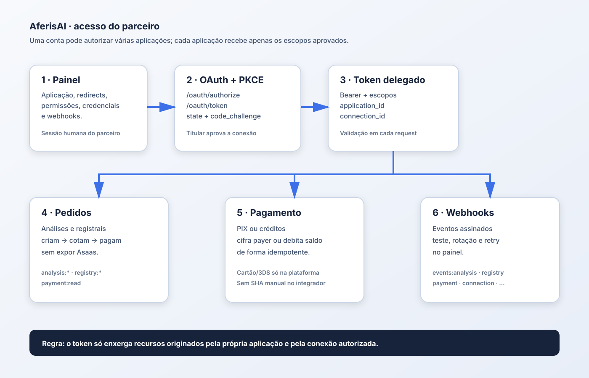

# API do parceiro — mapa de acesso e fluxo recomendado

Esta é a referência operacional para integrar uma aplicação parceira. Ela separa o que o parceiro configura no painel, o que a aplicação chama com OAuth delegado e o que continua restrito à sessão própria AferisAI.

## Regra principal

O integrador usa uma credencial OAuth e chama apenas os recursos pertencentes à conexão autorizada pelo titular. A API verifica token válido, escopo na credencial e na conexão, aplicação/conexão do recurso, permissões da organização e estado operacional.

Não use endpoints internos de cotação, preview ou gateway diretamente. O SDK recomendado reduz a integração a `connect`, `createOrder`, `getOrder` e `confirmPayment`.

A checklist de produto e o que ainda não está liberado no backend principal fica em `backend/docs/partner-integration-readiness.md` no workspace de desenvolvimento.

## Desenho visual



## Acesso delegado da aplicação

| Área | Endpoint | Escopo | Uso |
| --- | --- | --- | --- |
| Análises | `POST /v1/partner/analyses` | `analysis:submit:upload` | Enviar matrícula/arquivo |
| Análises | `GET /v1/partner/analyses` e `GET /{id}` | `analysis:read` | Listar e acompanhar |
| Análises | `GET /{id}/result`, `/report.pdf`, `/complete.pdf`, `/original` | `analysis:read` | Ler e baixar resultados |
| Análises | `GET /v1/partner/analyses/{id}/certificate-options` e `/quotes` | `analysis:quote` | Consultar opções e cotação |
| Análises | `POST /v1/partner/analyses/{id}/quotes` | `analysis:quote` | Criar cotação |
| Análises | `POST /v1/partner/analyses/{id}/pix` | `analysis:pay` | Criar PIX, aceitando `payer` no mesmo fluxo |
| Análises | `POST /v1/partner/analyses/{id}/credits` | `payment:credits` | Debitar saldo confirmado |
| Análises | `GET /v1/partner/analyses/{id}/pix` | `payment:read` | Ler PIX sem duplicar cobrança |
| Registrais | `POST /v1/partner/registry-requests/number` e `/address` | `registry:submit` | Criar pedido |
| Registrais | `GET /v1/partner/registry-requests` e `/{id}` | `registry:read` | Listar e consultar |
| Registrais | `POST /v1/partner/registry-requests/{id}/preview` | `registry:preview` | Simular custo sem cobrar |
| Registrais | `GET /{id}/certificate-options` | `certificate:read` | Consultar certidões disponíveis |
| Registrais | `GET/POST /v1/partner/registry-requests/{id}/quote` | `registry:quote` | Consultar ou criar cotação |
| Registrais | `POST /v1/partner/registry-requests/{id}/pix` | `registry:pay` | Criar PIX, aceitando `payer` no mesmo fluxo |
| Registrais | `POST /v1/partner/registry-requests/{id}/credits` | `payment:credits` | Debitar saldo confirmado |
| Registrais | `GET /v1/partner/registry-requests/{id}/pix` | `payment:read` | Ler PIX existente |
| Certidões | `GET /v1/partner/analyses/{id}/certificates` e `/{task}/document` | `certificate:read` | Listar e baixar |
| Métricas | `GET /v1/partner/metrics` e `/applications/{id}/metrics` | sessão do parceiro | Consultar métricas |
| Comissões | `GET /v1/partner/commissions` | sessão do parceiro | Consultar extrato |

Os recursos são filtrados por `application_id` e pela conexão do titular. Um token não pode consultar recurso de outra aplicação, organização ou conexão.

## Webhooks

Webhooks são configurados no painel do parceiro por aplicação, não pelo token delegado: listar/selecionar eventos, criar/consultar destino, testar, ativar/suspender, remover, listar/consultar/re enviar entregas e preparar/testar/ativar rotação de chave em `/v1/partner/applications/{id}/webhook-endpoint*` e `/webhook-deliveries*`.

Eventos só são entregues quando o titular concedeu `events:analysis`, `events:registry`, `events:payment`, `events:acquisition`, `events:certificate`, `events:connection`, `events:credential` ou `events:commission`. A chave aparece uma única vez; valide a assinatura usando o corpo bruto.

## Configuração no painel

Com sessão humana, o parceiro pode consultar redirects, permissões e credenciais; emitir no máximo duas credenciais ativas; revogar credencial; configurar eventos, destino, teste, status, rotação, entregas e reenvio; e administrar pessoas, convites, papéis, suspensão e reativação conforme seu papel.

Redirect local é permitido somente fora de produção para `http://localhost`, `127.0.0.1` ou `::1`. Em produção use HTTPS público. O redirect precisa estar previamente cadastrado.

## Inventário da sessão humana do parceiro

Além dos recursos delegados, o painel usa sessão humana em `/v1/partner` para:

- `POST/GET/DELETE /v1/partner/sessions`, `/sessions/current` e `/sessions/current/csrf`;
- `GET /v1/partner/organizations`, logo e troca de organização;
- `GET /v1/partner/applications`, aplicação, redirects, permissões e credenciais;
- configuração, teste, rotação, status e entregas de `/v1/partner/applications/{id}/webhook-endpoint*`;
- pessoas, convites, papéis, suspensão e reativação em `/v1/partner/people*` e `/invitations*`;
- métricas, comissões, recuperação de senha/MFA e passkeys.

Essa sessão administra a integração. Ela não substitui o consentimento do titular e não deve ser usada para executar pedidos em nome de uma conta conectada.

## OAuth e escopos

O fluxo usa Authorization Code + PKCE S256: registrar redirect, abrir `/oauth/authorize` com `state` e `code_challenge`, aprovar na tela AferisAI e trocar o código em `/oauth/token`. O valor `scopes=["all"]` é expandido pelo servidor para os escopos que a credencial já possui; não concede acesso novo.

## Fora do acesso delegado

O token OAuth não abre sessão humana, senha, MFA ou passkey; não acessa outra organização/conexão; não escolhe preço, vencimento ou proprietário da cobrança; não acessa Asaas, banco ou documentos fora do recurso autorizado; não cadastra redirect livre; e não cria nova cobrança ao consultar um PIX.

`/v1/payments/*` continua sendo o fluxo de sessão própria. A exceção funcional é que os endpoints delegados de PIX aceitam `payer` no mesmo POST e criam o perfil cifrado na conta conectada, eliminando `user.session_required`. A identidade já cadastrada continua imutável: outro documento retorna conflito auditável.

Créditos ainda não são um escopo delegado. Cartões e 3DS permanecem somente na plataforma; o parceiro não recebe PAN, CVV ou desafio de cartão.

## Fluxo simples recomendado

```text
connect() -> createOrder(input) -> getOrder(id) -> confirmPayment(id, { payer, legal_acceptance }) -> getOrder(id)
```

O servidor calcula e valida as evidências jurídicas oficiais. O integrador não deve chamar Asaas, gerar SHA manualmente ou repetir POST após timeout sem consultar o estado da ordem.

### Estado da migração

O exemplo consulta `GET /v1/legal/catalog` na API AferisAI e valida o contrato `legal_policy_version` + `documents` (`version`, `sha256`, `url`). O envelope `legal_policy_version` + `documents` usado pelos endpoints de PIX/créditos é montado exclusivamente com os valores do catálogo remoto. Não há leitura de documentos locais, cálculo de SHA ou fallback silencioso: erro do endpoint e catálogo inválido interrompem o fluxo de forma explícita.
